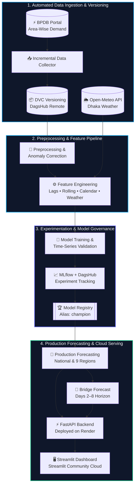
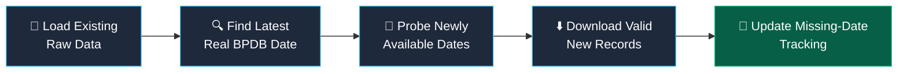
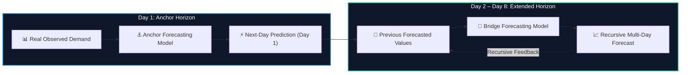
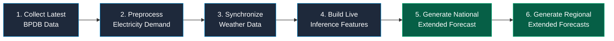

<div align="center">

<!-- Animated Soft Wave Header -->


<!-- Animated Typing Headline -->
<a href="https://github.com/estkayon/Bangladesh-Electricity-Demand-Forecasting-MLOps">
  
</a>

<br/>

<!-- Animated Tech Stack Icons -->
<p align="center">
  <a href="https://skillicons.dev">
    
  </a>
</p>

<!-- Status & Metric Badges -->
<p align="center">
  
  
  
  
  
  
</p>

<!-- Live Deployment Portals -->
<p align="center">
  <a href="https://bd-electricity-demand-forecast.streamlit.app/" target="_blank">
    
  </a>
  <a href="https://bd-electricity-demand-api.onrender.com" target="_blank">
    
  </a>
  <a href="https://bd-electricity-demand-api.onrender.com/docs" target="_blank">
    
  </a>
</p>

</div>

---

## 📌 Executive Overview

An end-to-end **MLOps-powered electricity demand forecasting platform for Bangladesh**, built using real BPDB electricity demand data, weather data, machine learning, DVC, MLflow, FastAPI, Streamlit, Docker, GitHub Actions, and cloud deployment.

The system supports both **national** and **regional next-day electricity demand forecasting**, along with an **extended multi-day forecast** generated through a bridge forecasting strategy.

<details>
<summary><b>📑 Quick Navigation (Table of Contents)</b></summary>

1. [Live Demo & Cloud Deployment](#-live-demo--cloud-deployment)
2. [Core Platform Capabilities](#-core-platform-capabilities)
3. [End-to-End MLOps Architecture](#-end-to-end-mlops-architecture)
4. [Data Sources & Incremental Ingestion](#-data-sources--incremental-ingestion)
5. [Forecasting Scope & Multi-Day Horizon](#-forecasting-scope--multi-day-horizon)
6. [Machine Learning & Validation Benchmarks](#-machine-learning--validation-benchmarks)
7. [Feature Engineering & Data Quality](#-feature-engineering--data-quality)
8. [MLflow Model Registry & DVC Versioning](#-mlflow-model-registry--dvc-versioning)
9. [CI/CD & Automated Daily Forecast Refresh](#-cicd--automated-daily-forecast-refresh)
10. [FastAPI Backend & Streamlit Dashboard](#-fastapi-backend--streamlit-dashboard)
11. [Project Structure](#-project-structure)
12. [Local Setup, Docker & Pipeline Execution](#-local-setup-docker--pipeline-execution)
13. [Technology Stack, Highlights & Roadmap](#-technology-stack-highlights--roadmap)

</details>


## 🌐 Live Demo & Cloud Deployment

| Service Layer | Hosting Platform | Production URL | Operational Role |
| :--- | :--- | :--- | :--- |
| 🖥️ **Streamlit Dashboard** | Streamlit Community Cloud | [**bd-electricity-demand-forecast.streamlit.app**](https://bd-electricity-demand-forecast.streamlit.app/) | Interactive visualization & forecast lookup UI |
| ⚡ **FastAPI Backend** | Render | [**bd-electricity-demand-api.onrender.com**](https://bd-electricity-demand-api.onrender.com) | Production REST API serving live & extended predictions |
| 📘 **FastAPI Documentation** | Render (Swagger UI) | [**bd-electricity-demand-api.onrender.com/docs**](https://bd-electricity-demand-api.onrender.com/docs) | Interactive OpenAPI specification & endpoint testing |

> [!NOTE]
> **Cloud Deployment Architecture:**  
> - **Backend:** FastAPI is deployed on **Render**. The production container pulls required DVC data from remote storage before starting the API.  
> - **Frontend:** The dashboard is deployed on **Streamlit Community Cloud**. The dashboard communicates with the public Render API using an environment-configured `API_BASE_URL`.


## 🚀 Core Platform Capabilities

This project builds a complete forecasting platform that:

<table>
<tr>
<td width="50%" valign="top">

#### 📊 Data & Feature Engineering
- **Collects electricity demand data** automatically from BPDB
- **Collects weather data** from Open-Meteo
- **Cleans and preprocesses** historical electricity demand
- **Handles missing dates** and known anomalies
- **Builds time-series, weather, holiday, and calendar-based features**

#### 🧠 Modeling & Forecasting
- **Trains and evaluates** multiple machine learning models
- **Performs national and regional** electricity demand forecasting
- **Generates extended multi-day forecasts**

</td>
<td width="50%" valign="top">

#### ⚙️ MLOps, Serving & Automation
- **Tracks experiments and registered models** using MLflow and DagsHub
- **Serves predictions** through a FastAPI backend
- **Provides an interactive** Streamlit dashboard
- **Uses DVC** for data and pipeline versioning
- **Uses Docker** for reproducible deployment
- **Uses GitHub Actions** for CI and automated data refresh
- **Automatically updates production forecasts** when new BPDB data becomes available

</td>
</tr>
</table>


## 🏗️ End-to-End MLOps Architecture




## 📡 Data Sources & Incremental Ingestion

<table>
<tr>
<td width="52%" valign="top">

### ⚡ Bangladesh Power Development Board
Area-wise electricity demand data is collected from:  
🔗 [https://misc.bpdb.gov.bd/area-wise-demand](https://misc.bpdb.gov.bd/area-wise-demand)

The dataset covers **nine BPDB regions**:
| Zone A | Zone B | Zone C |
| :---: | :---: | :---: |
| `Dhaka` | `Rajshahi` | `Sylhet` |
| `Chittagong` | `Comilla` | `Barisal` |
| `Khulna` | `Mymensingh` | `Rangpur` |

*The collector is incremental and checks newly published BPDB dates automatically.*

</td>
<td width="48%" valign="top">

### 🌦️ Weather Data (Open-Meteo)
Weather information is collected from **Open-Meteo** for Dhaka.

**Weather features include:**
- 🌡️ **Maximum temperature**
- ❄️ **Minimum temperature**
- 📊 **Mean temperature**
- 🌧️ **Precipitation**
- 💧 **Rainfall**

</td>
</tr>
</table>

### 🔄 Incremental BPDB Data Collection Workflow
The collector avoids redownloading the full historical dataset every day. Historical missing dates are preserved but are not repeatedly requested during every daily refresh. The parser supports BPDB table structure changes, including both older and newer layouts.




## 🎯 Forecasting Scope & Multi-Day Horizon

| Scope | Horizon | Architectural Description |
| :--- | :---: | :--- |
| **National Forecasting** | `Next-Day (Day 1)` | Predicts next-day electricity demand for Bangladesh using aggregated regional demand. |
| **Regional Forecasting** | `Next-Day (Day 1)` | Produces independent next-day forecasts for all nine BPDB regions. |
| **Extended Forecasting** | `8-Day Horizon` | Combines Day 1 anchor predictions with a recursive multi-day bridge forecasting model (Day 2 – Day 8). |

### 🔮 Extended 8-Day Forecasting Architecture




## 🧠 Machine Learning & Validation Benchmarks

Multiple forecasting approaches were evaluated using time-series validation.

### 1️⃣ National Production Model & Cross-Validation

<table>
<tr>
<td width="45%" valign="top">

#### 🏆 National Production Pipeline
The national production model uses:
- **Pipeline:** `StandardScaler` + `Ridge Regression`
- **Selected Parameter:** `alpha = 0.01`

#### 📊 2026 Holdout Performance
| Metric | Score |
| :--- | :--- |
| **MAE** | `743.59 MW` |
| **RMSE** | `1027.79 MW` |
| **MAPE** | `5.68%` |

</td>
<td width="55%" valign="top">

#### 📉 National Cross-Validation Results

| Model | Mean MAPE | Selection Status |
| :--- | :---: | :---: |
| **Tuned Ridge Regression** | **4.89%** | 🏆 **Selected for Production** |
| Ridge Regression | 4.91% | Evaluated |
| Persistence Baseline | 5.66% | Baseline |
| Random Forest | 5.71% | Evaluated |
| XGBoost | 6.05% | Evaluated |

*The tuned Ridge model was selected for production.*

</td>
</tr>
</table>

---

### 2️⃣ Regional Forecasting Strategy

Each region was evaluated separately. The production system selects either **Ridge Regression** or a **Persistence Baseline** depending on validation performance.

| Region | Production Strategy | Region | Production Strategy | Region | Production Strategy |
| :--- | :---: | :--- | :---: | :--- | :---: |
| **Dhaka** | `Ridge` | **Khulna** | `Ridge` | **Sylhet** | `Ridge` |
| **Chittagong** | `Ridge` | **Mymensingh** | `Ridge` | **Rajshahi** | `Persistence Baseline` |
| **Comilla** | `Ridge` | **Rangpur** | `Ridge` | **Barisal** | `Persistence Baseline` |

> [!TIP]
> **Why Hybrid Model Selection?** This prevents forcing a machine learning model onto regions where a simple baseline is more reliable.

---

### 3️⃣ Extended Forecast Model (Bridge Strategy)

A separate bridge forecasting model is used for multi-day forecasting.

**Bridge features include:**
- **Lag Features:** `Lag 1` • `Lag 2` • `Lag 3` • `Lag 7` • `Lag 14` • `Lag 21` • `Lag 30`
- **Rolling Aggregations:** `Rolling 7-day demand` • `Rolling 14-day demand` • `Rolling 30-day demand`
- **Calendar & Temporal:** `Weekend indicators` • `Holiday indicators` • `Trend features`

<table>
<tr>
<td width="50%" valign="top">

#### 🇧🇩 National Extended Forecast Backtest
| Strategy | Backtest MAPE |
| :--- | :---: |
| **Bridge Forecast** | **7.01%** |
| Persistence Baseline | 8.25% |

**Production Policy:**
- `Day 1` → **Anchor model**
- `Day 2-8` → **Bridge model**

</td>
<td width="50%" valign="top">

#### 🧭 Regional Extended Forecast Backtest
| Strategy | Backtest MAPE |
| :--- | :---: |
| **Hybrid Forecast** | **7.86%** |
| Persistence Baseline | 9.33% |

**Hybrid Architecture:**
- `Day 1` → **Region-specific anchor strategy**
- `Day 2-8` → **Region-specific bridge model**

</td>
</tr>
</table>


## 🛠️ Feature Engineering & Data Quality

<table>
<tr>
<td width="33%" valign="top">

### ⚡ Demand Features
- Demand lag 1
- Demand lag 7
- Demand lag 14
- Rolling mean 7 days
- Rolling mean 14 days
- Rolling mean 30 days
- Load-shedding lag features

</td>
<td width="33%" valign="top">

### 📅 Calendar Features
- Day of week
- Month
- Year
- Weekend indicator
- Bangladesh public holiday indicator

*For Bangladesh, **Friday and Saturday** are treated as weekend days.*

</td>
<td width="34%" valign="top">

### 🌦️ Weather Features
- Maximum temperature
- Minimum temperature
- Mean temperature
- Precipitation
- Rainfall

</td>
</tr>
</table>

### 🛡️ Data Quality Handling
The preprocessing pipeline includes:
- **Missing-date detection** & **Complete regional date-grid creation**
- **Time-series interpolation** & **Numerical type validation**
- **Duplicate handling** & **Missing-value validation**
- **Known anomaly correction** & **Separation of real and imputed observations**

> [!IMPORTANT]
> The system does **not** create artificial future actual-demand rows. Future dates exist only in the forecasting layer.


## 📦 MLflow Model Registry & DVC Versioning

<table>
<tr>
<td width="50%" valign="top">

### 📈 MLflow and Model Registry
DagsHub hosts the MLflow tracking server and model registry. MLflow is used for:
- Experiment tracking, Parameter logging & Metric logging
- Model comparison & Model artifact storage
- Model registration & Production model aliases

Production models use the `champion` alias. Regional models are independently registered and versioned.

**Registered model examples:**
```text
bangladesh-electricity-demand-ridge
bangladesh-electricity-demand-bridge
bangladesh-electricity-demand-dhaka
bangladesh-electricity-demand-dhaka-bridge
bangladesh-electricity-demand-chittagong
bangladesh-electricity-demand-chittagong-bridge
```

</td>
<td width="50%" valign="top">

### 🗂️ DVC Data Versioning
DVC remote storage is hosted through DagsHub. DVC is used to version:
- Raw BPDB electricity data & Weather data
- Processed datasets, Feature datasets & Inference datasets
- National bridge forecasts & Regional bridge forecasts

The DVC pipeline is defined in `dvc.yaml`.

**Main pipeline stages:**
```text
preprocess
build_target
build_features
build_regional_target
build_regional_features
build_inference_features
```

</td>
</tr>
</table>


## 🔄 CI/CD & Automated Daily Forecast Refresh

### ⚙️ Automated Live Forecast Pipeline (`src/pipeline/refresh_live_forecasts.py`)



<table>
<tr>
<td width="48%" valign="top">

### ✅ Continuous Integration (GitHub Actions)
GitHub Actions automatically runs CI on pushes to `main` and pull requests.

**CI checks include:**
1. Repository checkout
2. Python installation
3. Dependency installation
4. Python syntax validation
5. Core dependency import tests
6. FastAPI application import test
7. DVC pipeline validation

</td>
<td width="52%" valign="top">

### ⏰ Automated Daily Forecast Refresh
A separate GitHub Actions workflow refreshes production data and forecasts automatically every day.

- **Schedule:** `09:17 AM` & `07:17 PM` Bangladesh Time
- **Automated Execution Flow:**
  `DVC Pull` → `BPDB Data Collection` → `Weather Synchronization` → `Preprocessing` → `Inference Feature Generation` → `National Forecast` → `Regional Forecasts` → `DVC Update` → `DVC Push` → `Git Metadata Commit`

*If BPDB has not published new data, the latest real observation remains unchanged. When new data appears, the pipeline incorporates it automatically.*

</td>
</tr>
</table>


## ⚡ FastAPI Backend & 🖥️ Streamlit Dashboard

<table>
<tr>
<td width="52%" valign="top">

### ⚡ FastAPI Backend
- **Base URL:** [https://bd-electricity-demand-api.onrender.com](https://bd-electricity-demand-api.onrender.com)
- **API Docs:** [https://bd-electricity-demand-api.onrender.com/docs](https://bd-electricity-demand-api.onrender.com/docs)

| HTTP Method | Endpoint | Capability |
| :---: | :--- | :--- |
| `GET` | `/` | Root API welcome & service status |
| `GET` | `/health` | System health check |
| `GET` | `/regions` | List supported BPDB regions |
| `GET` | `/predict/latest` | Live next-day demand prediction |
| `GET` | `/predict/extended` | Extended multi-day (8-day) forecast |
| `GET` | `/predict/date` | Historical prediction lookup by date |
| `GET` | `/history` | Historical evaluation & demand records |
| `GET` | `/model/info` | Production model metadata |

**Example Request:**
```http
GET /predict/latest?region=National
```

</td>
<td width="48%" valign="top">

### 🖥️ Streamlit Dashboard
- **Live URL:** [https://bd-electricity-demand-forecast.streamlit.app/](https://bd-electricity-demand-forecast.streamlit.app/)

**Dashboard Features Include:**
- 🌍 National and regional selection
- ⚡ Latest observed demand
- 🔮 Next-day prediction
- 📅 Extended forecast
- 📈 Interactive charts
- 🔍 Historical prediction lookup
- ⚖️ Actual vs predicted comparison
- ℹ️ Model information
- 🟢 Forecast status information

</td>
</tr>
</table>


## 📂 Project Structure

<details open>
<summary><b>🗂️ Click to expand/collapse complete project directory tree</b></summary>

```text
Bangladesh-Electricity-Demand-Forecasting-MLOps/
│
├── .github/
│   └── workflows/
│       ├── ci.yml
│       └── live_forecast_refresh.yml
│
├── data/
│   ├── raw/
│   │   ├── area_wise_demand.csv
│   │   ├── dhaka_weather.csv
│   │   └── missing_dates.csv
│   │
│   └── processed/
│       ├── area_wise_demand_processed.csv
│       ├── national_daily_demand.csv
│       ├── regional_daily_demand.csv
│       ├── model_features.csv
│       ├── regional_model_features.csv
│       ├── national_inference_features.csv
│       ├── regional_inference_features.csv
│       ├── bridge_forecast.csv
│       └── regional_bridge_forecast.csv
│
├── src/
│   ├── api/
│   │   └── app.py
│   ├── data/
│   │   ├── collect_data.py
│   │   ├── collect_weather.py
│   │   ├── preprocess.py
│   │   ├── check_missing_dates.py
│   │   └── retry_missing_dates.py
│   ├── features/
│   │   ├── build_target.py
│   │   ├── build_features.py
│   │   ├── build_regional_target.py
│   │   ├── build_regional_features.py
│   │   └── build_inference_features.py
│   ├── models/
│   │   ├── train.py
│   │   ├── final_train.py
│   │   ├── train_regional.py
│   │   ├── train_bridge_model.py
│   │   ├── train_regional_bridge_models.py
│   │   ├── generate_bridge_forecast.py
│   │   ├── generate_regional_bridge_forecast.py
│   │   ├── time_series_validation.py
│   │   ├── regional_time_series_validation.py
│   │   └── ...
│   ├── pipeline/
│   │   └── refresh_live_forecasts.py
│   └── logger.py
│
├── dashboard.py
├── Dockerfile
├── dvc.yaml
├── dvc.lock
├── requirements.txt
└── README.md
```

</details>


## 💻 Local Setup, Docker & Pipeline Execution

### 1️⃣ Environment & Repository Setup

```bash
# Clone the Repository
git clone [https://github.com/estkayon/Bangladesh-Electricity-Demand-Forecasting-MLOps.git](https://github.com/estkayon/Bangladesh-Electricity-Demand-Forecasting-MLOps.git)
cd Bangladesh-Electricity-Demand-Forecasting-MLOps

# Create and Activate Conda Environment
conda create -n bdpower python=3.11
conda activate bdpower

# Install Dependencies
pip install -r requirements.txt

# Pull Versioned Data from DVC Remote
dvc pull -r origin
```

### 2️⃣ Configure Environment Variables
Create a `.env` file in the root directory (**Do not commit `.env` to Git**):

```env
MLFLOW_TRACKING_URI=your_mlflow_tracking_uri
MLFLOW_TRACKING_USERNAME=your_dagshub_username
MLFLOW_TRACKING_PASSWORD=your_dagshub_token
```

### 3️⃣ Run Services, Docker & Pipelines

<table>
<tr>
<td width="50%" valign="top">

#### ⚡ Run FastAPI & Streamlit Locally
```bash
# Run the FastAPI Backend
uvicorn src.api.app:app --host 0.0.0.0 --port 8000
# Swagger Docs: [http://127.0.0.1:8000/docs](http://127.0.0.1:8000/docs)

# Run the Streamlit Dashboard
streamlit run dashboard.py
```

#### 🐳 Docker Containerization
```bash
# Build Image
docker build -t bd-electricity-api .

# Run Container
docker run --rm -p 8000:8000 --env-file .env bd-electricity-api
```
- **Local API:** `http://127.0.0.1:8000`
- **Swagger UI:** `http://127.0.0.1:8000/docs`

</td>
<td width="50%" valign="top">

#### 🔄 Run the Live Forecast Pipeline
```bash
python -m src.pipeline.refresh_live_forecasts
```
*Automatically performs:*  
`BPDB data collection` → `preprocessing` → `weather synchronization` → `inference feature generation` → `national forecast generation` → `regional forecast generation`

#### 📦 Reproduce the DVC Pipeline
```bash
# Reproduce pipeline stages
dvc repro

# Check data & pipeline status
dvc status

# Push updated data to remote
dvc push -r origin
```

</td>
</tr>
</table>


## 🧰 Technology Stack, Highlights & Roadmap

| Domain | Technologies & Platforms |
| :--- | :--- |
| **Programming & Data Processing** | `Python` • `Pandas` • `NumPy` |
| **Machine Learning** | `Scikit-learn` • `XGBoost` |
| **Experiment Tracking & Versioning** | `MLflow` • `DagsHub` • `DVC` |
| **Backend API & Frontend UI** | `FastAPI` • `Uvicorn` • `Streamlit` • `Plotly` |
| **DevOps, MLOps & Cloud** | `Docker` • `Git` • `GitHub` • `GitHub Actions` • `Render` • `Streamlit Community Cloud` |

<table>
<tr>
<td width="50%" valign="top">

### 🌟 Key Engineering Highlights
This project goes beyond model training and demonstrates a complete production-oriented machine learning workflow:
- Real-world public data ingestion & incremental data collection
- Automated missing-date tracking & data anomaly correction
- Time-series validation & baseline comparison
- Region-specific model selection & model registry (`champion` alias)
- Multi-day recursive forecasting (Anchor + Bridge strategy)
- DVC pipeline reproducibility & remote DVC storage
- Containerized API deployment & continuous integration
- Scheduled production refresh, public REST API & interactive cloud dashboard

</td>
<td width="50%" valign="top">

### 🔮 Future Improvements
Potential future improvements include:
- Automated model retraining based on new data volume
- Model drift detection
- Forecast uncertainty intervals
- Additional weather stations & region-specific weather features
- Advanced ensemble forecasting
- Transformer-based time-series forecasting
- Monitoring and alerting
- Dedicated cloud database
- More granular electricity demand data

</td>
</tr>
</table>


## 👨‍💻 Author

<div align="center">

### **Md. Estiak Rahman Ayon**
*Computer Science graduate interested in:*

`Machine Learning` • `MLOps` • `Artificial Intelligence` • `Data Science` • `Production ML Systems` • `Software Engineer`

</div>

---

> [!WARNING]
> **Disclaimer:** Electricity demand information is collected from publicly available BPDB data sources. Forecasts generated by this system should not be considered official BPDB forecasts or operational recommendations.

<!-- Animated Footer -->
